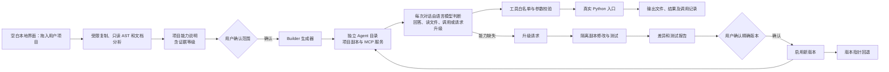
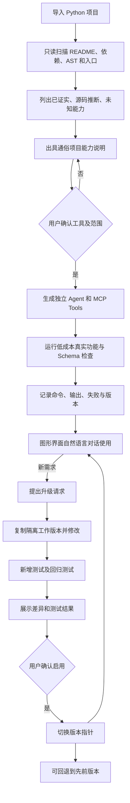

# 架构与流程

## 一次新项目的完整开发流程

## 目录职责

- `personal_agent_builder/analysis.py`：只读分析和中文说明。
- `single_file.py`：对单个陌生 Python 文件调用本机模型做源码理解；可安全封装时在导入副本准备调用原函数的入口，等待用户确认与试运行。
- `project_review.py`：对本次导入的多文件 Python 项目进行只读模型复核；以代码为准整理三项通俗说明与候选参数提示。它不能创造静态扫描未找到的程序入口，也不会运行项目或使用按项目名称预存的说明。
- `webapp.py`、`web/`：空白本地浏览器界面、拖放导入、报告、确认与聊天；仅绑定 `127.0.0.1`。
- `proposal.py`：对简单 `argparse` 入口提出保守的工具清单和测试参数，不运行导入代码。
- 候选工具按静态识别出的命令和参数创建；示例项目没有专属路由。普通表格文件的字段推断属于文件格式适配，非项目身份判断。
- `generator.py`：校验确认记录并产生独立 Agent、MCP 服务和项目副本。
- `runtime.py`：输入和输出 Schema、路径、实际进程调用及日志。
- `router.py`、`conversation.py`：通过本机已登录的官方语言模型逐次理解用户需求，按需只读查看允许的文件，并选择回答、调用已批准工具、补充信息或请求升级；模型不能直接执行项目代码。
- 每个生成的智能体把最近十轮用户话语和简短答复写入自己的 `records/context.json`。下一轮路由会同时看到这些问答、待处理的本次文件和已核验结果；用户补充追问或引用上次模型时不必重述整项需求。记录不包含完整文件内容和原始程序输出，工作台重新打开后可显示最近问答。能力分组的上次配置用于连续修改；缺少明确指代时仍须追问。
- 当前浏览器页面还为每个智能体保留独立的消息与结果节点、输入草稿和待添加文件。切换智能体时交换对应视图；后台请求携带固定的智能体标识，完成后只写回所属视图。页面刷新后的持久范围仍是服务端最近十轮简短问答。
- 创建前的模型讨论允许零个澄清问题，最多一个真正阻碍方案形成的问题；零问题时直接生成待确认的交互方案。升级修改器会读取当前项目配置，为“其余沿用默认”形成可测试设置，并在报告中列出假设。程序升级仍须在副本测试和确认后启用。
- 模型判断需要扩展程序时，向修改器提交结合前文整理的完整需求；界面显示该需求，再由用户点击准备、查看隔离副本的差异与测试结果，最终确认启用。
- `upgrade_builder.py`、`upgrade.py`：语言模型准备新增或修改代码，在隔离副本中暂存、测试、展示差异，经用户确认后启用并支持回退。
- 已通过测试但未启用的升级报告保存在智能体自己的隔离提案目录。工作台重新打开时只恢复最新待确认报告，不自动启用；启用后报告标记为已处理。
- `artifacts/web_builder/agents/`：用户从空白界面生成的 Agent；运行记录和输出受 `.gitignore` 排除。
- `agents/`：历史上经用户确认范围后生成的两个测试 Agent，不自动载入空白界面。

## 信任边界

分析阶段不导入用户模块。运行阶段只执行经用户批准、复制到 Agent 内的 Python 文件，使用参数白名单、路径限制和超时。**Python 项目本身仍是不可信代码**：当前运行器尚未提供操作系统级隔离，不能承诺对恶意入口形成强沙箱。真实部署前应在容器或受限账户内运行，并进一步限制文件、网络和计算资源。
